<p align="center">
  
</p>

<p align="center">
  <a href="#overview">Overview</a> ·
  <a href="#app-preview">Screenshots</a> ·
  <a href="#features">Features</a> ·
  <a href="#demo-accounts">Demo accounts</a> ·
  <a href="#getting-started">Setup</a> ·
  <a href="#project-structure">Structure</a> ·
  <a href="#team--contributions">Team</a>
</p>

## Overview

Ataya is a native iOS application built as a team project at Bahrain Polytechnic. It helps reduce food waste by giving donors, NGOs, and administrators a shared space to submit, review, schedule, collect, and track food donations.

The application brings together donation details, food safety checks, pickup coordination, status updates, and administrative oversight. Campaigns, rewards, and impact insights encourage continued community participation.

## App preview

### Welcome screens

<table align="center" class="app-gallery">
  <tr>
    <td align="center" width="33%"><strong>Welcome to Ataya</strong><br><br>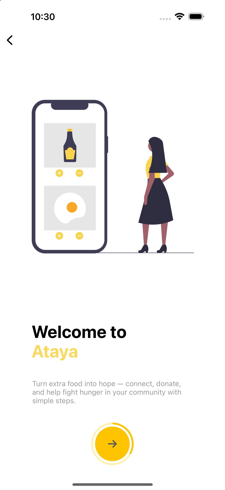</td>
    <td align="center" width="33%"><strong>Share food, spread hope</strong><br><br>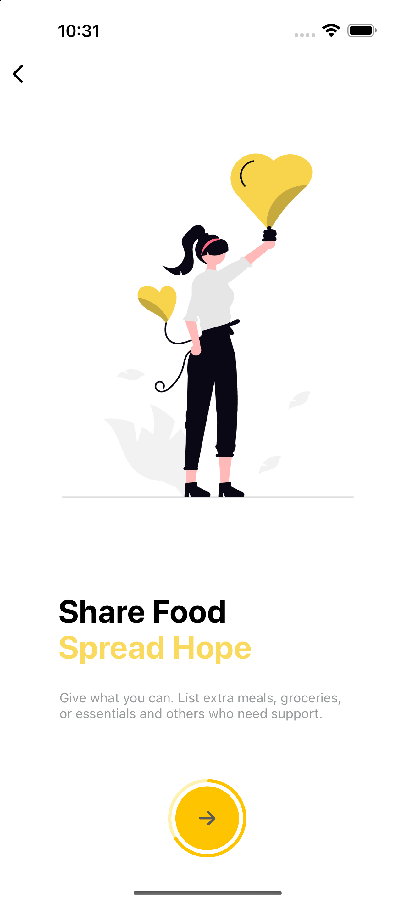</td>
    <td align="center" width="33%"><strong>Updates &amp; support</strong><br><br>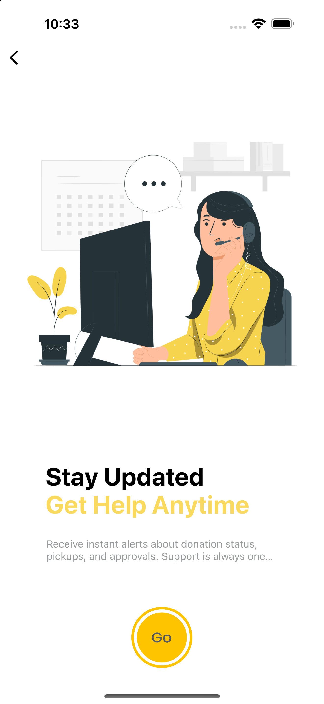</td>
  </tr>
</table>

### Account screens

<table align="center" class="app-gallery">
  <tr>
    <td align="center" width="33%"><strong>Choose your role</strong><br><br>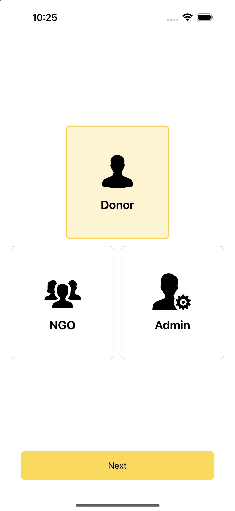</td>
    <td align="center" width="33%"><strong>Sign in</strong><br><br>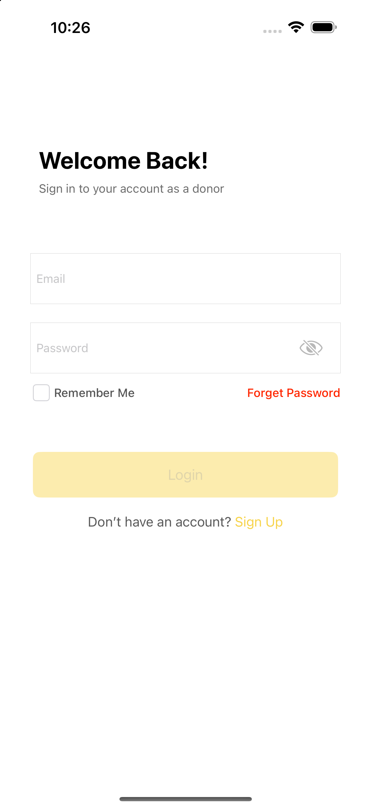</td>
    <td align="center" width="33%"><strong>Sign up</strong><br><br>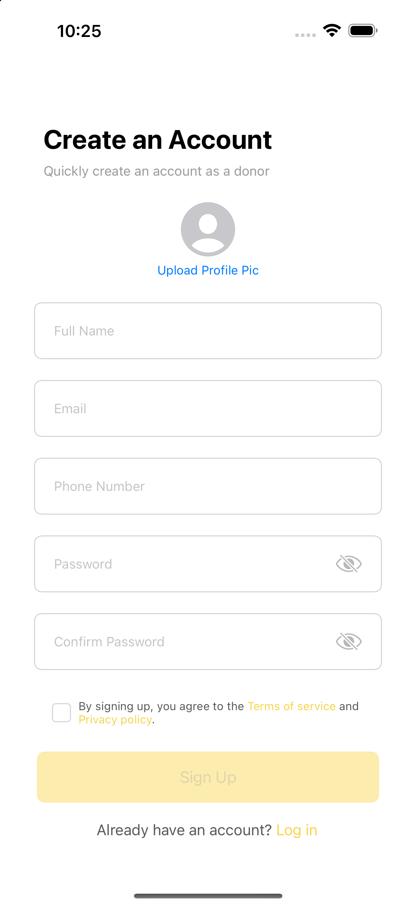</td>
  </tr>
</table>

### Inside the app


<table align="center" class="app-gallery">
  <tr>
    <td align="center" width="33%"><strong>Donor home</strong><br><br>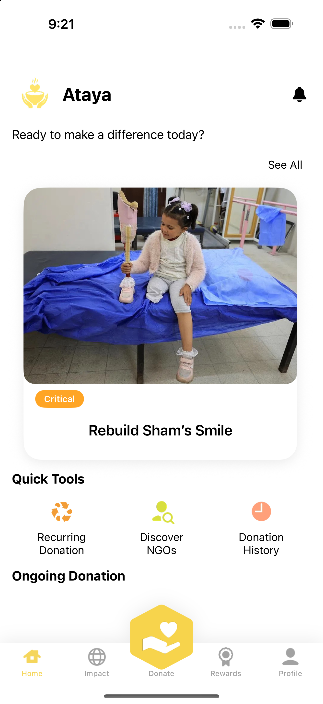</td>
    <td align="center" width="33%"><strong>NGO dashboard</strong><br><br>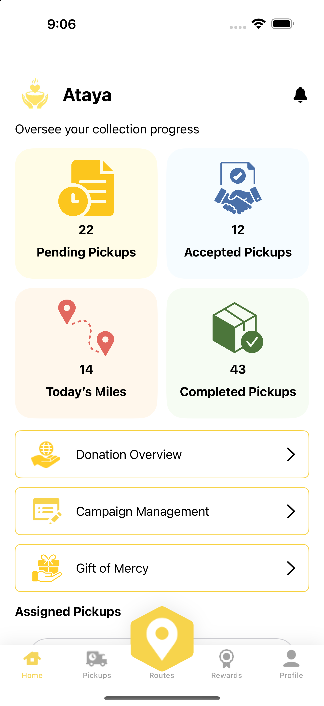</td>
    <td align="center" width="33%"><strong>Admin dashboard</strong><br><br>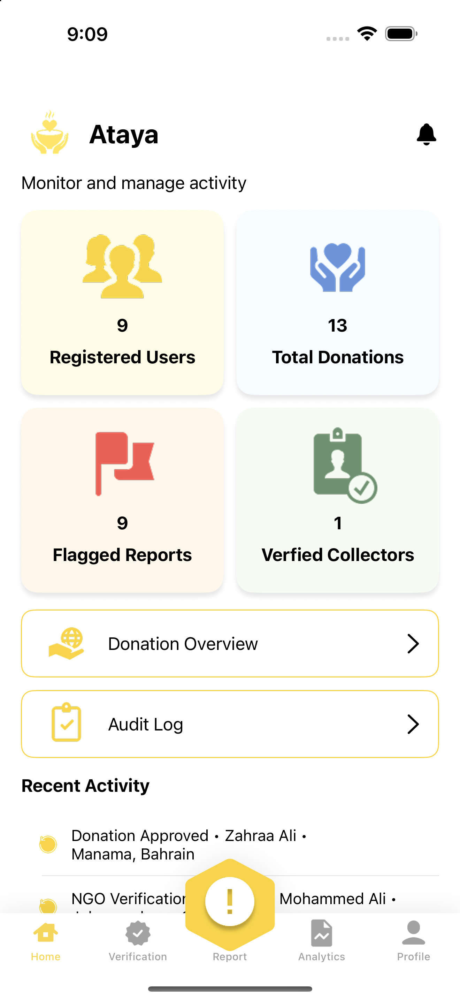</td>
  </tr>
  <tr>
    <td align="center" width="33%"><strong>Donation options</strong><br><br>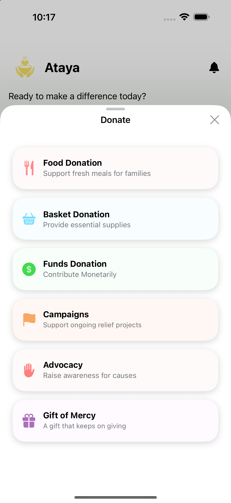</td>
    <td align="center" width="33%"><strong>Seasonal campaigns</strong><br><br>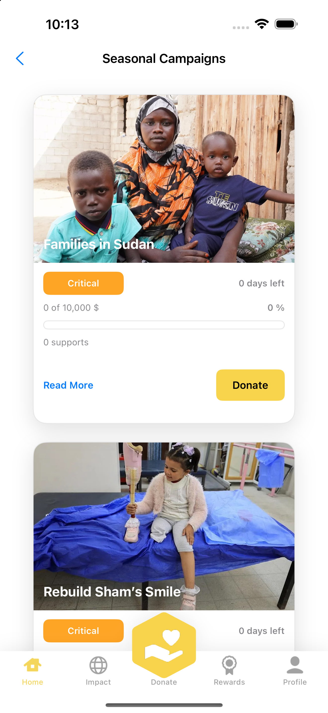</td>
    <td align="center" width="33%"><strong>Rewards &amp; achievements</strong><br><br>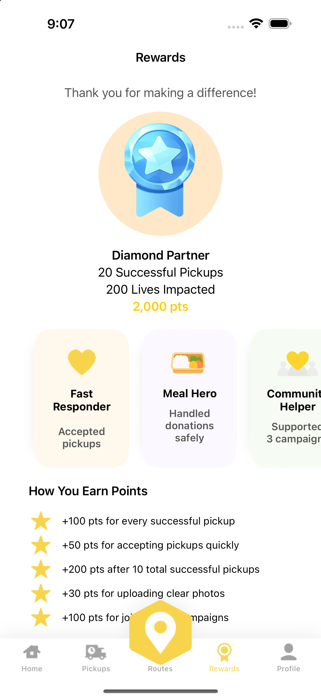</td>
  </tr>
</table>

*Screenshots show the app running in the iOS Simulator with demonstration data.*

## How it works

1. **Submit a donation.** A donor adds photos, food details, quantity, expiry information, and safety information.
2. **Review and coordinate.** An NGO reviews the request and coordinates a pickup.
3. **Track progress.** Participants follow the donation through its status updates and history.
4. **Recognize participation.** Rewards, achievements, and impact insights highlight community involvement.
5. **Oversee activity.** Administrators monitor donations, verification, reports, and audit activity.

## Features

### Main features

- **User authentication:** Separate sign-up and sign-in flows for donors and NGOs, with access for existing administrators.
- **Food donation submission:** Add food details, quantities, categories, expiry information, photos, and notes.
- **Food safety and reporting:** Record safety information and report donations that need review.
- **Organization discovery:** Browse NGOs and view their profiles and donation options.
- **Pickup scheduling:** Review donation requests and coordinate pickup times and locations.
- **Donation status tracking:** Follow donations through their status updates.
- **Donation history and activity logs:** Review previous donations and recorded activity.
- **Recurring donations:** Create repeated donation schedules and view their history.
- **Impact dashboard:** View donation activity through summaries and charts.
- **Notifications:** View donation-related updates and manage notification preferences.
- **Admin dashboard:** Monitor platform activity and donation information.
- **Verification and reports:** Review NGO and collector verification records and flagged content.
- **Achievements and rewards:** Track points, badges, and participation milestones.

### Additional features

These features were added beyond the project’s main requirements.

- **Seasonal campaigns:** Create and manage campaigns, browse available campaigns, and view their progress.
- **Gift of Mercy:** Make a donation on behalf of someone else.
- **Basket donations and monetary support:** Explore additional donation options for supporting NGOs.
- **Community reviews:** Share and view feedback about NGOs.
- **Help and support:** Access help, submit support requests, and provide feedback.
- **Ratings and reputation:** View ratings and reputation information on organization profiles.

## User roles & access

Ataya provides three account types. Select your role on the role-selection screen and tap **Next**.

| Role | Main tools |
| --- | --- |
| **Donor** | Submit food donations, discover NGOs, track donations, set recurring donations, support campaigns, and view impact and rewards. |
| **NGO** | Coordinate pickups, monitor collection activity, manage campaigns, and view rewards. |
| **Admin** | Monitor platform activity, review verification requests, handle reports, and access analytics and audit logs. |

## Demo accounts

Use these existing accounts to explore the donor, NGO, and administrator experiences. Select the corresponding role before signing in.

| Role | Email | Password |
| --- | --- | --- |
| **Donor** | `amoonz4905@gmail.com` | `amoon` |
| **NGO** | `hoppal@gmail.com` | `hoppal` |
| **Admin** | `ali@gmail.com` | `ali123` |

For donor and NGO accounts, choose **Already have an account? Log in** after selecting the role. The admin login also requires **Confirm Password**: enter the same password in both fields.

These accounts work with the original Ataya Firebase project. They are not automatically available if you connect the app to a different Firebase project.

### Sign up & account recovery

- **Donor:** Register with a name, email, phone number, password, and matching password confirmation. A profile photo can be added during registration.
- **NGO:** Register with an organization name, email, phone number, and matching passwords, then complete **Organization Details**. New NGO records enter the verification workflow with a pending approval status.
- **Admin:** Uses an existing administrator account. Admin access requires a matching Firebase user profile with the `admin` role.
- **Password recovery:** **Forget Password** sends a Firebase password-reset email to the account's email address.
- **Switch accounts:** Use **Profile → Logout** to return to role selection.

## Technology stack

| Technology | Purpose |
| --- | --- |
| **Swift & UIKit** | Native iOS application logic and interface. |
| **Storyboards & Auto Layout** | Screen composition, navigation, and layout. |
| **Firebase Authentication** | Account authentication. |
| **Cloud Firestore** | Application data, including users, donations, campaigns, and reviews. |
| **Cloudinary** | Image uploads through the application's upload configuration. |
| **DGCharts** | Charts and visual analytics. |
| **Swift Package Manager** | Dependency management. |
| **Xcode & Git/GitHub** | Development, simulator testing, and collaboration. |

## Getting started

### Requirements

- macOS with Xcode and an iOS SDK that supports **iOS 18.5 or later**, the project's deployment target.
- An iOS Simulator or a compatible iPhone.
- Internet access to resolve Swift packages and connect to backend services.
- A Firebase project and Cloudinary configuration for your own development environment.

### Run locally

1. Clone the repository:

   ```bash
   git clone https://github.com/maramsshubbar/Ataya.git
   cd Ataya
   ```

2. Open **`Ataya.xcodeproj`** in Xcode and allow Swift Package Manager to resolve the dependencies.
3. To explore the existing demo, use the supplied Firebase configuration and the demo accounts above. To use your own backend, follow **Backend configuration** below.
4. Select the **Ataya** scheme and an iPhone Simulator running iOS 18.5 or later.
5. Run the application with **⌘R**. For a physical device, configure your development team under **Signing & Capabilities**.

### Backend configuration

**Firebase**

Register an iOS app in your Firebase project using the bundle identifier selected in Xcode. Add your own `GoogleService-Info.plist` to the Ataya app target, enable email/password authentication, and configure Cloud Firestore and its access rules. The app also attempts anonymous sign-in during startup; enable that provider if you retain the current startup flow.

Existing roles and demonstration data belong to the original project and are not automatically created in a new Firebase project. Admin and NGO access require the corresponding role records expected by the application.

**Cloudinary**

Update the cloud name and unsigned upload preset in `Ataya/Services/Cloudinary/CloudinaryManager.swift` for your own Cloudinary account. Configure the preset's upload restrictions in Cloudinary. Private API secrets and service-account credentials must stay outside the iOS app and repository.

**Distribution**

This repository contains the Xcode project. It does not currently provide a public App Store or TestFlight installation link. Screenshots and the recorded demo are available below.

## Project structure

The full project tree is displayed below, including controllers, models, services, storyboards, asset catalogs, Xcode configuration, and documentation. Git internals and macOS `.DS_Store` files are omitted.

```text
Ataya/
├── Ataya/
│   ├── Controllers/
│   │   ├── Ameena/
│   │   │   ├── DonateBaskets&Funds/
│   │   │   │   ├── AddPaymentMethodViewController.swift
│   │   │   │   ├── BasketDonationViewController.swift
│   │   │   │   ├── DonateFundsViewController.swift
│   │   │   │   └── DonationSuccessViewController.swift
│   │   │   ├── ImpactDash/
│   │   │   │   ├── ImpactCharts.swift
│   │   │   │   ├── ImpactDashboardViewController.swift
│   │   │   │   ├── ImpactDetailsViewController.swift
│   │   │   │   └── SharePreviewViewController.swift
│   │   │   └── RecurringDonations/
│   │   │       ├── HistoryStatusPopupViewController.swift
│   │   │       ├── HistoryViewController.swift
│   │   │       ├── RecurringAddressDetailsViewController.swift
│   │   │       ├── RecurringAddressListViewController.swift
│   │   │       ├── RecurringConfirmLocationViewController.swift
│   │   │       ├── RecurringDonation.swift
│   │   │       ├── RecurringDonationDetailsViewController.swift
│   │   │       ├── RecurringDonationDraft.swift
│   │   │       ├── RecurringDonationViewController.swift
│   │   │       ├── RecurringHistoryCellViewController.swift
│   │   │       ├── RecurringLocationChoiceViewController.swift
│   │   │       ├── RecurringMyAddressListTableViewController.swift
│   │   │       └── RecurringPopupConfirmPickupViewController.swift
│   │   ├── Fatema/
│   │   │   ├── Add Food Donation/
│   │   │   │   ├── AddFoodDonationViewController.swift
│   │   │   │   ├── AdvocacyDetailViewController.swift
│   │   │   │   ├── CampaignCellDashboard.swift
│   │   │   │   ├── DonateOption.swift
│   │   │   │   ├── DonateViewController.swift
│   │   │   │   ├── DonationCardCell.swift
│   │   │   │   ├── DonorDashboardViewController.swift
│   │   │   │   ├── DonorTabBarController.swift
│   │   │   │   ├── EnterDetailsViewController.swift
│   │   │   │   ├── OngoingDonationCell.swift
│   │   │   │   ├── OngoingDonationItem.swift
│   │   │   │   ├── SafetyVC.swift
│   │   │   │   └── UploadPhotosViewController.swift
│   │   │   ├── Food Safety/
│   │   │   │   ├── Donation.swift
│   │   │   │   ├── DonationDraftSaver.swift
│   │   │   │   ├── DonationService.swift
│   │   │   │   ├── DonationStatus.swift
│   │   │   │   ├── FoodSafetyReport.swift
│   │   │   │   ├── InspectDonationViewController.swift
│   │   │   │   ├── NGODonationDetailsViewController.swift
│   │   │   │   ├── NGODonationOverviewCell.swift
│   │   │   │   └── NGODonationOverviewViewController.swift
│   │   │   └── GiftOfMercy/
│   │   │       ├── Donor/
│   │   │       │   ├── AmountSanitizer.swift
│   │   │       │   ├── AtayaGiftsIntroViewController.swift
│   │   │       │   ├── AtayaSuccessPopupViewController.swift
│   │   │       │   ├── CardChoiceCell.swift
│   │   │       │   ├── CardPreviewViewController.swift
│   │   │       │   ├── ChooseCardViewController.swift
│   │   │       │   ├── GiftCardCell.swift
│   │   │       │   ├── GiftCardDesign.swift
│   │   │       │   ├── GiftCertificateDetailsViewController.swift
│   │   │       │   ├── GiftCertificateRequest.swift
│   │   │       │   ├── GiftsChooseViewController.swift
│   │   │       │   ├── MercyBackend.swift
│   │   │       │   └── MercyGift.swift
│   │   │       ├── Helpers/
│   │   │       │   ├── GiftCertificateMailer.swift
│   │   │       │   └── Helpers.swift
│   │   │       └── NGO/
│   │   │           ├── AddEditCardDesignViewController.swift
│   │   │           ├── AddEditGiftViewController.swift
│   │   │           ├── CardDesign.swift
│   │   │           ├── CardDesignManagementCell.swift
│   │   │           ├── CardDesignPreviewViewController.swift
│   │   │           ├── CardDesignService.swift
│   │   │           ├── Gift.swift
│   │   │           ├── GiftManagementCell.swift
│   │   │           ├── GiftOfMercyHubViewController.swift
│   │   │           ├── GiftOrderDetailsViewController.swift
│   │   │           ├── GiftOrderItem.swift
│   │   │           ├── GiftOrdersListViewController.swift
│   │   │           ├── GiftService.swift
│   │   │           ├── ManageCardDesignsListViewController.swift
│   │   │           ├── ManageGiftsListViewController.swift
│   │   │           ├── NGOOrdersViewController.swift
│   │   │           └── UIImageView+Remote.swift
│   │   ├── Maram/
│   │   │   ├── Admin Panel/
│   │   │   │   ├── AboutMeViewController.swift
│   │   │   │   ├── ActivityCell.swift
│   │   │   │   ├── AdminDashboardViewController.swift
│   │   │   │   ├── AdminDonationDetailsViewController.swift
│   │   │   │   ├── AdminProfileViewController.swift
│   │   │   │   ├── AdminTabBarController.swift
│   │   │   │   ├── AnalyticsViewController.swift
│   │   │   │   ├── AuditLogTableViewCell.swift
│   │   │   │   ├── AuditLogViewController.swift
│   │   │   │   ├── DonationOverviewCell.swift
│   │   │   │   ├── DonationOverviewViewController.swift
│   │   │   │   ├── NGOVerificationTableViewCell.swift
│   │   │   │   ├── NGOVerificationViewController.swift
│   │   │   │   ├── ReportCardCell.swift
│   │   │   │   ├── ReportManagementViewController.swift
│   │   │   │   ├── Reports.swift
│   │   │   │   ├── RoundedTabBar.swift
│   │   │   │   └── UIExtensions.swift
│   │   │   ├── Seasonal Campaigns/
│   │   │   │   ├── CampaignDetailViewController.swift
│   │   │   │   ├── CampaignManagementViewController.swift
│   │   │   │   ├── CreateCampaignViewController.swift
│   │   │   │   ├── DonorCampaignDetailViewController.swift
│   │   │   │   └── DonorCampaignsListViewController.swift
│   │   │   └── Social Gamification/
│   │   │       ├── BadgeCardCell.swift
│   │   │       ├── CouponDetailsViewController.swift
│   │   │       ├── LeaderboardViewController.swift
│   │   │       ├── NgoRewardsSyncService.swift
│   │   │       ├── RewardsNgoViewController.swift
│   │   │       ├── RewardsSyncService.swift
│   │   │       ├── RewardsViewController.swift
│   │   │       ├── RewardTier.swift
│   │   │       └── SpacedListCell.swift
│   │   ├── Rana/
│   │   │   ├── DonorPickup/
│   │   │   │   ├── AddressModel.swift
│   │   │   │   ├── AddressRuntimeStore.swift
│   │   │   │   ├── AuthGate.swift
│   │   │   │   ├── ConfirmLocationViewController.swift
│   │   │   │   ├── DraftSession.swift
│   │   │   │   ├── LocationStorage.swift
│   │   │   │   ├── MyAddressDetailsViewController.swift
│   │   │   │   ├── MyAddressListTableViewController.swift
│   │   │   │   ├── MyAddressListViewController.swift
│   │   │   │   ├── PickUpDateViewController.swift
│   │   │   │   └── PopupConfimPickupViewController.swift
│   │   │   ├── Help & Support/
│   │   │   │   ├── FAQDetailsViewController.swift
│   │   │   │   ├── FAQListViewController.swift
│   │   │   │   ├── HelpSupportDonorViewController.swift
│   │   │   │   ├── HelpSupportViewController.swift
│   │   │   │   ├── MySupportTicketsDetailsViewController.swift
│   │   │   │   ├── MySupportTicketsViewController.swift
│   │   │   │   ├── SubmitSupportTicketViewController.swift
│   │   │   │   └── SupportTicketStatus.swift
│   │   │   ├── NGOPickup/
│   │   │   │   ├── PickupDetailsViewController.swift
│   │   │   │   ├── PickupFirestoreService.swift
│   │   │   │   ├── PickupListCardCell.swift
│   │   │   │   ├── PickupListCardCellViewController.swift
│   │   │   │   ├── PickupModels.swift
│   │   │   │   └── StatusProgressViewController.swift
│   │   │   ├── Notification/
│   │   │   │   ├── NotificationCardCell.swift
│   │   │   │   ├── NotificationSettingsViewController.swift
│   │   │   │   └── NotificationViewController.swift
│   │   │   └── appcolors.swift
│   │   ├── Ruqaya/
│   │   │   ├── Donation Status/
│   │   │   │   └── DonationStatusViewController.swift
│   │   │   ├── DonationHist/
│   │   │   │   ├── DonationCell.swift
│   │   │   │   ├── DonationDetailsRViewControllerViewController.swift
│   │   │   │   ├── DonationHistoryItem.swift
│   │   │   │   └── DonationHistoryViewController.swift
│   │   │   ├── LogIn/
│   │   │   │   ├── AdminLoginViewController.swift
│   │   │   │   ├── DonorLoginViewController.swift
│   │   │   │   ├── DonorSignUpViewController.swift
│   │   │   │   ├── ForgotPasswordViewController.swift
│   │   │   │   ├── NGOdetailsViewController.swift
│   │   │   │   ├── NGOLoginViewController.swift
│   │   │   │   ├── NGOOrgDetailsViewController.swift
│   │   │   │   ├── NGOSignUpViewController.swift
│   │   │   │   ├── NGOSubmittedViewController.swift
│   │   │   │   ├── UserSelectionViewController.swift
│   │   │   │   ├── Welcome1ViewController.swift
│   │   │   │   ├── Welcome2ViewController.swift
│   │   │   │   ├── Welcome3ViewController.swift
│   │   │   │   └── WelcomeViewController.swift
│   │   │   ├── MyRev/
│   │   │   │   ├── CollectorMyReviewsViewController.swift
│   │   │   │   ├── MyReviewsViewController.swift
│   │   │   │   ├── ReviewCardCell.swift
│   │   │   │   └── ReviewItem.swift
│   │   │   └── ngoDashboard/
│   │   │       ├── AssignedPickupCell.swift
│   │   │       ├── AssignedPickupItem.swift
│   │   │       ├── AssignedPickupViewController.swift
│   │   │       ├── ngoDashboardViewController.swift
│   │   │       ├── NGOTabBarController.swift
│   │   │       └── RoutesViewController.swift
│   │   └── Sarah/
│   │       ├── DiscoverNGO/
│   │       │   ├── DiscoverNGOViewController.swift
│   │       │   ├── NGOCardCell.swift
│   │       │   └── NGOdiscoverProfileViewController.swift
│   │       ├── NGOapp/
│   │       │   ├── ActionPopupViewController.swift
│   │       │   ├── NGOApplicationViewController.swift
│   │       │   ├── PopupNGOApplicationViewController.swift
│   │       │   └── ReportReviewViewController.swift
│   │       └── UserP/
│   │           ├── DonorAboutMeViewController.swift
│   │           ├── DonorProfileViewController.swift
│   │           ├── FeedbackPopupViewController.swift
│   │           ├── NGOAboutMeViewController.swift
│   │           ├── NGOProfileViewController.swift
│   │           └── ReviewsListViewController.swift
│   ├── Managers/
│   │   ├── AuthManager.swift
│   │   ├── DraftDonation.swift
│   │   ├── FirestoreSmokeTest.swift
│   │   ├── ImageLoader.swift
│   │   ├── UIColor+Hex.swift
│   │   └── UIView+CardStyle.swift
│   ├── Models/
│   │   ├── Maram Models/
│   │   │   ├── AppHelpers.swift
│   │   │   ├── Campaign.swift
│   │   │   ├── CountryCell.swift
│   │   │   └── DonationItem.swift
│   │   └── Sara Models/
│   │       ├── DororInfo.swift
│   │       ├── DummyDatabase.swift
│   │       ├── Ngo.swift
│   │       ├── NgoApplication.swift
│   │       ├── NGOdiscover.swift
│   │       ├── Report_Model.swift
│   │       └── Review.swift
│   ├── Resources/
│   │   ├── AppDelegate.swift
│   │   ├── PaddingLabel.swift
│   │   ├── SceneDelegate.swift
│   │   └── UIStyle+Ataya.swift
│   ├── Services/
│   │   ├── Backend/
│   │   │   └── UserSession.swift
│   │   └── Cloudinary/
│   │       ├── CloudinaryManager.swift
│   │       └── CloudinaryUploadResponse.swift
│   ├── Views/
│   │   ├── Assets.xcassets/
│   │   │   ├── 1.imageset/
│   │   │   │   ├── 1.png
│   │   │   │   └── Contents.json
│   │   │   ├── 2.imageset/
│   │   │   │   ├── 2.png
│   │   │   │   └── Contents.json
│   │   │   ├── 3.imageset/
│   │   │   │   ├── 3.png
│   │   │   │   └── Contents.json
│   │   │   ├── 4/
│   │   │   │   ├── addDonation.imageset/
│   │   │   │   │   ├── Contents.json
│   │   │   │   │   └── pic-2.png
│   │   │   │   ├── details.imageset/
│   │   │   │   │   ├── Contents.json
│   │   │   │   │   └── Document.png
│   │   │   │   ├── safety.imageset/
│   │   │   │   │   ├── Contents.json
│   │   │   │   │   └── Protect.png
│   │   │   │   ├── upload.imageset/
│   │   │   │   │   ├── Contents.json
│   │   │   │   │   └── Full Image.png
│   │   │   │   └── Contents.json
│   │   │   ├── 5/
│   │   │   │   ├── pic.imageset/
│   │   │   │   │   ├── Contents.json
│   │   │   │   │   └── pic.png
│   │   │   │   └── Contents.json
│   │   │   ├── admin.imageset/
│   │   │   │   ├── admin.png
│   │   │   │   └── Contents.json
│   │   │   ├── AdminProfile.imageset/
│   │   │   │   ├── Contents.json
│   │   │   │   └── image 54.png
│   │   │   ├── Adv.imageset/
│   │   │   │   ├── Contents.json
│   │   │   │   └── palestine.png
│   │   │   ├── agreement copy.imageset/
│   │   │   │   ├── agreement copy.png
│   │   │   │   └── Contents.json
│   │   │   ├── AidBridge.imageset/
│   │   │   │   ├── Contents.json
│   │   │   │   └── Ellipse 26.png
│   │   │   ├── AppIcon.appiconset/
│   │   │   │   ├── app.png
│   │   │   │   └── Contents.json
│   │   │   ├── Audit.imageset/
│   │   │   │   ├── Audit.png
│   │   │   │   └── Contents.json
│   │   │   ├── baby_formula.imageset/
│   │   │   │   ├── angle-left.png
│   │   │   │   ├── Contents.json
│   │   │   │   └── Img-3.png
│   │   │   ├── Basic basket.imageset/
│   │   │   │   ├── Basic basket.png
│   │   │   │   └── Contents.json
│   │   │   ├── box.imageset/
│   │   │   │   ├── Contents.json
│   │   │   │   └── pic.png
│   │   │   ├── C.imageset/
│   │   │   │   ├── C.png
│   │   │   │   └── Contents.json
│   │   │   ├── camera.imageset/
│   │   │   │   ├── Camera.png
│   │   │   │   └── Contents.json
│   │   │   ├── CB.imageset/
│   │   │   │   ├── CB.jpg
│   │   │   │   └── Contents.json
│   │   │   ├── Certificate 1.imageset/
│   │   │   │   ├── Certificate.png
│   │   │   │   └── Contents.json
│   │   │   ├── Check Mark.imageset/
│   │   │   │   ├── Check Mark.png
│   │   │   │   └── Contents.json
│   │   │   ├── checkmark.imageset/
│   │   │   │   ├── checkmark.png
│   │   │   │   └── Contents.json
│   │   │   ├── ChickenBox.imageset/
│   │   │   │   ├── ChickenBox.jpg
│   │   │   │   └── Contents.json
│   │   │   ├── community.imageset/
│   │   │   │   ├── Contents.json
│   │   │   │   └── image_50-removebg-preview.png
│   │   │   ├── Confetti 1.imageset/
│   │   │   │   ├── Confetti.png
│   │   │   │   └── Contents.json
│   │   │   ├── Deliverytime.imageset/
│   │   │   │   ├── Contents.json
│   │   │   │   └── Deliverytime.png
│   │   │   ├── doc.imageset/
│   │   │   │   ├── Contents.json
│   │   │   │   └── doc.png
│   │   │   ├── dononrProfile.imageset/
│   │   │   │   ├── Contents.json
│   │   │   │   └── image 54.png
│   │   │   ├── donor.imageset/
│   │   │   │   ├── Contents.json
│   │   │   │   └── donor.png
│   │   │   ├── donor_home/
│   │   │   │   ├── babyformula.imageset/
│   │   │   │   │   ├── babyformula 1.png
│   │   │   │   │   ├── babyformula 2.png
│   │   │   │   │   ├── babyformula.png
│   │   │   │   │   └── Contents.json
│   │   │   │   ├── banana.imageset/
│   │   │   │   │   ├── banana 1.png
│   │   │   │   │   ├── banana 2.png
│   │   │   │   │   ├── banana.png
│   │   │   │   │   └── Contents.json
│   │   │   │   ├── campaign1.imageset/
│   │   │   │   │   ├── campaign1.png
│   │   │   │   │   └── Contents.json
│   │   │   │   ├── campaign2.imageset/
│   │   │   │   │   ├── campaign2.jpeg
│   │   │   │   │   └── Contents.json
│   │   │   │   ├── campaign3.imageset/
│   │   │   │   │   ├── campaign3.jpeg
│   │   │   │   │   └── Contents.json
│   │   │   │   ├── campaign4.imageset/
│   │   │   │   │   ├── campaign4.png
│   │   │   │   │   └── Contents.json
│   │   │   │   ├── clock.imageset/
│   │   │   │   │   ├── clock 1.png
│   │   │   │   │   ├── clock 2.png
│   │   │   │   │   ├── clock.png
│   │   │   │   │   └── Contents.json
│   │   │   │   ├── earthglobegrey.imageset/
│   │   │   │   │   ├── Contents.json
│   │   │   │   │   ├── earthglobegrey 1.png
│   │   │   │   │   ├── earthglobegrey 2.png
│   │   │   │   │   └── earthglobegrey.png
│   │   │   │   ├── earthglobeyellow.imageset/
│   │   │   │   │   ├── Contents.json
│   │   │   │   │   ├── earthglobeyellow 1.png
│   │   │   │   │   ├── earthglobeyellow 2.png
│   │   │   │   │   └── earthglobeyellow.png
│   │   │   │   ├── flour.imageset/
│   │   │   │   │   ├── Contents.json
│   │   │   │   │   ├── flour 1.png
│   │   │   │   │   ├── flour 2.png
│   │   │   │   │   └── flour.png
│   │   │   │   ├── housefillgrey.imageset/
│   │   │   │   │   ├── Contents.json
│   │   │   │   │   ├── housefillgrey 1.png
│   │   │   │   │   ├── housefillgrey 2.png
│   │   │   │   │   └── housefillgrey.png
│   │   │   │   ├── housefillyellow.imageset/
│   │   │   │   │   ├── Contents.json
│   │   │   │   │   ├── housefillyellow 1.png
│   │   │   │   │   ├── housefillyellow 2.png
│   │   │   │   │   └── housefillyellow.png
│   │   │   │   ├── Logo.imageset/
│   │   │   │   │   ├── Contents.json
│   │   │   │   │   ├── logowhite 1.png
│   │   │   │   │   ├── logowhite 2.png
│   │   │   │   │   └── logowhite.png
│   │   │   │   ├── main.imageset/
│   │   │   │   │   ├── Contents.json
│   │   │   │   │   ├── main 1.png
│   │   │   │   │   ├── main 2.png
│   │   │   │   │   └── main.png
│   │   │   │   ├── prizegrey.imageset/
│   │   │   │   │   ├── Contents.json
│   │   │   │   │   ├── prizegrey 1.png
│   │   │   │   │   ├── prizegrey 2.png
│   │   │   │   │   └── prizegrey.png
│   │   │   │   ├── prizeyellow.imageset/
│   │   │   │   │   ├── Contents.json
│   │   │   │   │   ├── prizeyellow 1.png
│   │   │   │   │   ├── prizeyellow 2.png
│   │   │   │   │   └── prizeyellow.png
│   │   │   │   ├── recycle.imageset/
│   │   │   │   │   ├── Contents.json
│   │   │   │   │   ├── recycle 1.png
│   │   │   │   │   ├── recycle 2.png
│   │   │   │   │   └── recycle.png
│   │   │   │   ├── searchclient.imageset/
│   │   │   │   │   ├── Contents.json
│   │   │   │   │   ├── searchclient 1.png
│   │   │   │   │   ├── searchclient 2.png
│   │   │   │   │   └── searchclient.png
│   │   │   │   ├── usergrey.imageset/
│   │   │   │   │   ├── Contents.json
│   │   │   │   │   ├── usergrey 1.png
│   │   │   │   │   ├── usergrey 2.png
│   │   │   │   │   └── usergrey.png
│   │   │   │   ├── useryellow.imageset/
│   │   │   │   │   ├── Contents.json
│   │   │   │   │   ├── useryellow 1.png
│   │   │   │   │   ├── useryellow 2.png
│   │   │   │   │   └── useryellow.png
│   │   │   │   └── Contents.json
│   │   │   ├── Emergency basket.imageset/
│   │   │   │   ├── Contents.json
│   │   │   │   └── Emergency basket.png
│   │   │   ├── Family Basket.imageset/
│   │   │   │   ├── Contents.json
│   │   │   │   └── Family Basket.png
│   │   │   ├── file.imageset/
│   │   │   │   ├── Contents.json
│   │   │   │   └── file.png
│   │   │   ├── fL.imageset/
│   │   │   │   ├── Contents.json
│   │   │   │   └── fL.png
│   │   │   ├── Flag.imageset/
│   │   │   │   ├── Contents.json
│   │   │   │   └── Flag.png
│   │   │   ├── food waste.imageset/
│   │   │   │   ├── ChatGPT_Image_Dec_23__2025_at_02_01_30_PM-removebg-preview.png
│   │   │   │   └── Contents.json
│   │   │   ├── foodSafety.imageset/
│   │   │   │   ├── Contents.json
│   │   │   │   └── pic-2.png
│   │   │   ├── forest.imageset/
│   │   │   │   ├── ChatGPT_Image_Dec_23__2025_at_02_05_11_PM-removebg-preview.png
│   │   │   │   └── Contents.json
│   │   │   ├── Frozen.imageset/
│   │   │   │   ├── Contents.json
│   │   │   │   └── Frozen.png
│   │   │   ├── gift-box.imageset/
│   │   │   │   ├── Contents.json
│   │   │   │   └── gift-box.png
│   │   │   ├── gifts_intro_banner.imageset/
│   │   │   │   ├── Contents.json
│   │   │   │   └── gifts_intro_banner.jpeg
│   │   │   ├── hand.imageset/
│   │   │   │   ├── Contents.json
│   │   │   │   └── pic.png
│   │   │   ├── Handmade.imageset/
│   │   │   │   ├── Contents.json
│   │   │   │   └── Handmade.png
│   │   │   ├── Healthy baket.imageset/
│   │   │   │   ├── Contents.json
│   │   │   │   └── Healthy baket.png
│   │   │   ├── Heart 1.imageset/
│   │   │   │   ├── Contents.json
│   │   │   │   └── Heart.png
│   │   │   ├── Heart.imageset/
│   │   │   │   ├── Contents.json
│   │   │   │   └── Heart.png
│   │   │   ├── Henry Beeston.imageset/
│   │   │   │   ├── Contents.json
│   │   │   │   └── Ellipse 27.png
│   │   │   ├── hex_report_bg.imageset/
│   │   │   │   ├── Contents.json
│   │   │   │   └── hex_report_bg.png
│   │   │   ├── homeCamp.imageset/
│   │   │   │   ├── campaign1.png
│   │   │   │   └── Contents.json
│   │   │   ├── hoppal.imageset/
│   │   │   │   ├── Contents.json
│   │   │   │   └── Ellipse 38.png
│   │   │   ├── HopPalImg.imageset/
│   │   │   │   ├── Contents.json
│   │   │   │   └── Ellipse 38.png
│   │   │   ├── ic_donate_center.imageset/
│   │   │   │   ├── Contents.json
│   │   │   │   ├── ic_donate_center 1.png
│   │   │   │   ├── ic_donate_center 2.png
│   │   │   │   └── ic_donate_center.png
│   │   │   ├── ic_outline-logout.imageset/
│   │   │   │   ├── Contents.json
│   │   │   │   └── ic_outline-logout.png
│   │   │   ├── ic_report_center.imageset/
│   │   │   │   ├── Contents.json
│   │   │   │   └── Icon 3.png
│   │   │   ├── Icon2.imageset/
│   │   │   │   ├── Contents.json
│   │   │   │   └── logo.png
│   │   │   ├── icons8-world-markets-50.imageset/
│   │   │   │   ├── Contents.json
│   │   │   │   └── icons8-world-markets-50.png
│   │   │   ├── ID Verified.imageset/
│   │   │   │   ├── Contents.json
│   │   │   │   └── ID Verified.png
│   │   │   ├── Image.imageset/
│   │   │   │   ├── Contents.json
│   │   │   │   └── Screenshot_2025-11-28_at_5.33.08_pm-removebg-preview.png
│   │   │   ├── Image1.imageset/
│   │   │   │   ├── Contents.json
│   │   │   │   └── Vector.png
│   │   │   ├── Image2.imageset/
│   │   │   │   ├── Contents.json
│   │   │   │   └── Ellipse 25.png
│   │   │   ├── Image3.imageset/
│   │   │   │   ├── Contents.json
│   │   │   │   └── Green and Yellow Geometric Community & Non-Profit Logo 1.png
│   │   │   ├── Image4.imageset/
│   │   │   │   ├── Contents.json
│   │   │   │   └── Ellipse 45.png
│   │   │   ├── Image6.imageset/
│   │   │   │   ├── 360_F_844870932_0yUYmV99Gho2aSqEoATaqGa57i9bewdc.jpg
│   │   │   │   └── Contents.json
│   │   │   ├── Image7.imageset/
│   │   │   │   ├── Contents.json
│   │   │   │   └── images.jpeg
│   │   │   ├── image88.imageset/
│   │   │   │   ├── Contents.json
│   │   │   │   └── image 88.png
│   │   │   ├── Jassim Ali.imageset/
│   │   │   │   ├── Contents.json
│   │   │   │   └── Ellipse 18.png
│   │   │   ├── KindWave.imageset/
│   │   │   │   ├── Contents.json
│   │   │   │   └── Ellipse 22.png
│   │   │   ├── last.imageset/
│   │   │   │   ├── Contents.json
│   │   │   │   └── image_51-2-removebg-preview.png
│   │   │   ├── LifeReachImg.imageset/
│   │   │   │   ├── Contents.json
│   │   │   │   └── Ellipse 25.png
│   │   │   ├── location (1).imageset/
│   │   │   │   ├── Contents.json
│   │   │   │   └── location (1).png
│   │   │   ├── Logo.imageset/
│   │   │   │   ├── Contents.json
│   │   │   │   └── Logo.png
│   │   │   ├── map.imageset/
│   │   │   │   ├── Contents.json
│   │   │   │   └── map 1.png
│   │   │   ├── meal.imageset/
│   │   │   │   ├── Contents.json
│   │   │   │   └── image 52.png
│   │   │   ├── MyAddress.imageset/
│   │   │   │   ├── Contents.json
│   │   │   │   └── MyAddress.png
│   │   │   ├── ngo.imageset/
│   │   │   │   ├── Contents.json
│   │   │   │   └── ngo.png
│   │   │   ├── Noor Mohd.imageset/
│   │   │   │   ├── Contents.json
│   │   │   │   └── Ellipse 19.png
│   │   │   ├── oil.imageset/
│   │   │   │   ├── Contents.json
│   │   │   │   └── oil.jpg
│   │   │   ├── p1.imageset/
│   │   │   │   ├── Contents 2.json
│   │   │   │   ├── Contents.json
│   │   │   │   ├── p1 2.png
│   │   │   │   └── p1.png
│   │   │   ├── p2.imageset/
│   │   │   │   ├── Contents.json
│   │   │   │   └── p2.png
│   │   │   ├── p3.imageset/
│   │   │   │   ├── Contents.json
│   │   │   │   └── p3.png
│   │   │   ├── package.imageset/
│   │   │   │   ├── Contents.json
│   │   │   │   └── package.png
│   │   │   ├── pdf.imageset/
│   │   │   │   ├── Contents 2.json
│   │   │   │   ├── Contents.json
│   │   │   │   ├── pdf 2.png
│   │   │   │   └── pdf.png
│   │   │   ├── People-2.imageset/
│   │   │   │   ├── Contents.json
│   │   │   │   └── People-2.png
│   │   │   ├── png.imageset/
│   │   │   │   ├── Contents.json
│   │   │   │   └── png.png
│   │   │   ├── PNR Code.imageset/
│   │   │   │   ├── Contents.json
│   │   │   │   └── PNR Code.png
│   │   │   ├── Products/
│   │   │   │   ├── canned-beans.imageset/
│   │   │   │   │   ├── Contents.json
│   │   │   │   │   └── nest-removebg-preview 3.png
│   │   │   │   ├── eggs.imageset/
│   │   │   │   │   ├── Contents.json
│   │   │   │   │   └── Img-2.png
│   │   │   │   ├── Img-4.imageset/
│   │   │   │   │   ├── Contents.json
│   │   │   │   │   └── Img-4.png
│   │   │   │   └── Contents.json
│   │   │   ├── profileImageView.imageset/
│   │   │   │   ├── Contents.json
│   │   │   │   └── front-view-woman-wearing-halal-outdoors-2.jpg
│   │   │   ├── PureRelief.imageset/
│   │   │   │   ├── Contents.json
│   │   │   │   └── Ellipse 21.png
│   │   │   ├── QR.imageset/
│   │   │   │   ├── Contents.json
│   │   │   │   └── QR.png
│   │   │   ├── Replay.imageset/
│   │   │   │   ├── Contents.json
│   │   │   │   └── Replay.png
│   │   │   ├── Rice Bowl .imageset/
│   │   │   │   ├── ChatGPT_Image_Dec_23__2025_at_01_54_27_PM-removebg-preview.png
│   │   │   │   └── Contents.json
│   │   │   ├── safety1.imageset/
│   │   │   │   ├── Contents.json
│   │   │   │   └── safety.png
│   │   │   ├── Star.imageset/
│   │   │   │   ├── Contents.json
│   │   │   │   └── Star.png
│   │   │   ├── success icon.imageset/
│   │   │   │   ├── Contents.json
│   │   │   │   └── PopupConfirmPickup-removebg-preview.png
│   │   │   ├── tab_analytics.imageset/
│   │   │   │   ├── Contents.json
│   │   │   │   └── Graph Report.png
│   │   │   ├── tab_empty.imageset/
│   │   │   │   ├── Contents.json
│   │   │   │   └── tab_empty.png
│   │   │   ├── tab_home.imageset/
│   │   │   │   ├── Contents 2.json
│   │   │   │   ├── Contents.json
│   │   │   │   ├── house fill 2.png
│   │   │   │   └── house fill.png
│   │   │   ├── tab_profile.imageset/
│   │   │   │   ├── Contents 2.json
│   │   │   │   ├── Contents.json
│   │   │   │   ├── Icon 5.png
│   │   │   │   └── Icon 6.png
│   │   │   ├── tab_verify.imageset/
│   │   │   │   ├── Contents.json
│   │   │   │   └── Icon 2-2.png
│   │   │   ├── tier_diamond.imageset/
│   │   │   │   ├── Contents.json
│   │   │   │   └── tier_diamond-removebg-preview.png
│   │   │   ├── tier_gold.imageset/
│   │   │   │   ├── Contents.json
│   │   │   │   └── Gold Donor Badge.png
│   │   │   ├── tier_silver.imageset/
│   │   │   │   ├── Contents.json
│   │   │   │   └── tier_silver-removebg-preview.png
│   │   │   ├── tier_starter.imageset/
│   │   │   │   ├── ChatGPT_Image_Jan_2__2026_at_10_53_06_AM-removebg-preview.png
│   │   │   │   └── Contents.json
│   │   │   ├── upload_placeholder.imageset/
│   │   │   │   ├── Contents.json
│   │   │   │   └── photo-upload.png
│   │   │   ├── Willam Smith.imageset/
│   │   │   │   ├── Contents.json
│   │   │   │   └── Ellipse 24.png
│   │   │   ├── World Markets.imageset/
│   │   │   │   ├── Contents.json
│   │   │   │   └── World Markets.png
│   │   │   └── Contents.json
│   │   └── Storyboards/
│   │       ├── Ameena/
│   │       │   ├── BasketFunds.storyboard
│   │       │   ├── Impact.storyboard
│   │       │   └── Recurring.storyboard
│   │       ├── Fatema/
│   │       │   ├── Add Food Donation/
│   │       │   │   ├── Add.storyboard
│   │       │   │   ├── CampaignCellDashboard.xib
│   │       │   │   ├── DonorDashboard.storyboard
│   │       │   │   └── OngoingDonationCell.xib
│   │       │   ├── Food Safety/
│   │       │   │   ├── NGODonationOverviewCell.xib
│   │       │   │   └── Safety.storyboard
│   │       │   └── GiftOfMercy/
│   │       │       ├── Donor.storyboard
│   │       │       └── NGO.storyboard
│   │       ├── Maram/
│   │       │   ├── Admin Panel/
│   │       │   │   ├── Admin.storyboard
│   │       │   │   ├── AuditLogTableViewCell.xib
│   │       │   │   ├── DonationOverviewCell.xib
│   │       │   │   ├── NGOVerificationTableViewCell.xib
│   │       │   │   └── ReportCardCell.xib
│   │       │   ├── Seasonal Campaigns/
│   │       │   │   └── Campaigns.storyboard
│   │       │   └── Social Gamification/
│   │       │       ├── BadgeCardCell.xib
│   │       │       └── Gamification.storyboard
│   │       ├── Rana/
│   │       │   ├── helpSupport.storyboard
│   │       │   ├── notification.storyboard
│   │       │   ├── Pickup.storyboard
│   │       │   └── PickupNGO.storyboard
│   │       ├── Ruqaya/
│   │       │   ├── DonationSt/
│   │       │   │   └── Base.lproj/
│   │       │   │       └── DonationStatus.storyboard
│   │       │   ├── DonHist/
│   │       │   │   └── DonationHist.storyboard
│   │       │   ├── MyRevi/
│   │       │   │   └── MyReviews.storyboard
│   │       │   ├── ngoDashboard1/
│   │       │   │   ├── AssignedPickupCell.xib
│   │       │   │   └── NGODash.storyboard
│   │       │   └── Main.storyboard
│   │       └── Sarah/
│   │           ├── DiscoverNGOs.storyboard
│   │           ├── DonorProfile.storyboard
│   │           ├── Main7.storyboard
│   │           ├── NgoApplication.storyboard
│   │           ├── NGOCardCell.xib
│   │           ├── NGOProfile.storyboard
│   │           └── Rate.storyboard
│   ├── ataya-logo.png
│   ├── GoogleService-Info.plist
│   └── Info.plist
├── Ataya.xcodeproj/
│   ├── project.xcworkspace/
│   │   ├── xcshareddata/
│   │   │   └── swiftpm/
│   │   │       ├── configuration/
│   │   │       └── Package.resolved
│   │   ├── xcuserdata/
│   │   │   ├── bp-36-224-10.xcuserdatad/
│   │   │   │   └── UserInterfaceState.xcuserstate
│   │   │   ├── bp-36-224-15.xcuserdatad/
│   │   │   │   └── UserInterfaceState.xcuserstate
│   │   │   ├── bp-36-224-16.xcuserdatad/
│   │   │   │   └── UserInterfaceState.xcuserstate
│   │   │   ├── fatemamaitham.xcuserdatad/
│   │   │   │   ├── IDEFindNavigatorScopes.plist
│   │   │   │   └── UserInterfaceState.xcuserstate
│   │   │   ├── maram.xcuserdatad/
│   │   │   │   └── UserInterfaceState.xcuserstate
│   │   │   ├── ruqaya.xcuserdatad/
│   │   │   │   └── UserInterfaceState.xcuserstate
│   │   │   └── zahraaahmed.xcuserdatad/
│   │   │       └── UserInterfaceState.xcuserstate
│   │   └── contents.xcworkspacedata
│   ├── xcshareddata/
│   │   └── xcschemes/
│   │       └── Ataya.xcscheme
│   ├── xcuserdata/
│   │   ├── fatemamaitham.xcuserdatad/
│   │   │   ├── xcdebugger/
│   │   │   │   └── Breakpoints_v2.xcbkptlist
│   │   │   └── xcschemes/
│   │   │       └── xcschememanagement.plist
│   │   ├── maram.xcuserdatad/
│   │   │   ├── xcdebugger/
│   │   │   │   └── Breakpoints_v2.xcbkptlist
│   │   │   └── xcschemes/
│   │   │       └── xcschememanagement.plist
│   │   └── zahraaahmed.xcuserdatad/
│   │       ├── xcdebugger/
│   │       │   └── Breakpoints_v2.xcbkptlist
│   │       └── xcschemes/
│   │           └── xcschememanagement.plist
│   └── project.pbxproj
├── docs/
│   └── images/
│       ├── account-roles.png
│       ├── admin-dashboard.jpg
│       ├── admin-dashboard.png
│       ├── ataya-banner.png
│       ├── ataya-banner.svg
│       ├── donation-options.jpg
│       ├── donation-options.png
│       ├── donor-home.jpg
│       ├── donor-home.png
│       ├── introduction-1.png
│       ├── introduction-2.png
│       ├── introduction-3.png
│       ├── ngo-dashboard.jpg
│       ├── ngo-dashboard.png
│       ├── rewards.jpg
│       ├── rewards.png
│       ├── seasonal-campaigns.jpg
│       ├── seasonal-campaigns.png
│       ├── sign-in.png
│       └── sign-up.png
└── README.md
```


## Design & demo

- **[Low-fidelity wireframes](https://www.canva.com/design/DAG1erTPoo4/Z8dxt8vH5zsRx8NBPeyM9Q/edit)** — early screen planning.
- **[High-fidelity design](https://www.figma.com/design/j7f3DAf6s2KBBC9eG7qS20/ATAYA?node-id=2180-3387)** — interface design in Figma.
- **[Recorded app demo](https://drive.google.com/file/d/1Ef5M4-UYlySGfNJ-J0YR7Gf02TSA0rpn/view?usp=sharing)** — walkthrough of the application.

## Team & contributions

| Team member | Main contributions |
| --- | --- |
| **Maram Shubbar** | Admin panel, achievements and rewards, seasonal and event campaigns. |
| **Fatema Maitham** | Food donation submission, food safety checks and reporting, Gift of Mercy. |
| **Ruqaya Khan** | Authentication, donation status tracking, donation history and activity logs, community reviews. |
| **Sarah Abdulla** | NGO discovery, verification and flagged-content workflows, rating and reputation. |
| **Rana Alqameesh** | Pickup scheduling, notifications, help and support. |
| **Ameena Khamis** | Recurring donations, impact dashboard, basket donations and monetary support. |

---

Built collaboratively at **Bahrain Polytechnic** to explore how mobile applications can support food sharing and community participation.
